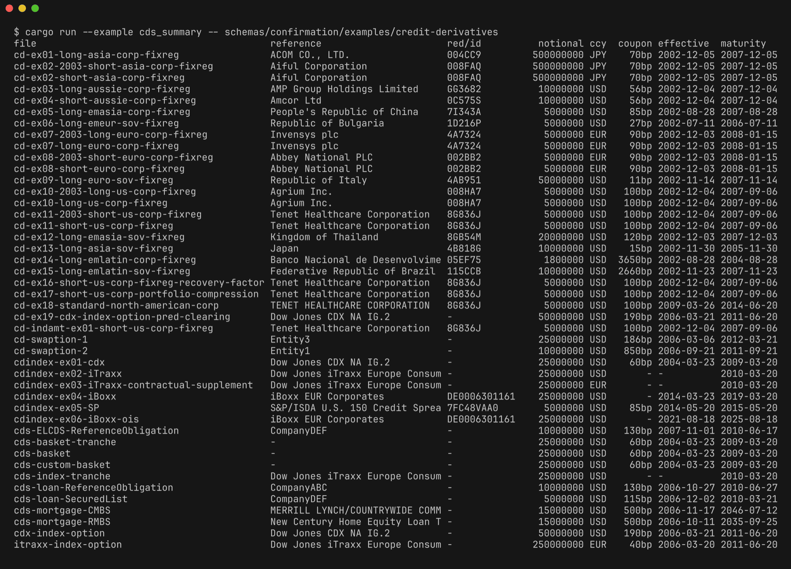

# fpml-rs

Parse, inspect and write FpML credit default swap confirmations as typed Rust values.



FpML is the XML standard ISDA publishes for OTC derivative trades. fpml-rs ships
serde bindings generated from the FpML 5.12 credit-derivatives schema, a
`parse` function that refuses to silently drop elements, a writer that
round-trips back to XML, and a small `key_terms` view of the headline economics.
All 44 files in the ISDA 5.12 credit-derivatives example folder parse, covering
single names, indices, tranches, baskets, swaptions and ABS CDS; the 24 `cd-ex*`
confirmations also re-serialize and re-parse to an equal value in the test
suite.

## Install

```toml
[dependencies]
fpml-rs = { git = "https://github.com/davidawad/fpml-rs", tag = "v0.1.0" }
```

The package is `fpml-rs`; the library is imported as `fpml`.

## Usage

```rust
let xml = std::fs::read_to_string("cd-ex01-long-asia-corp-fixreg.xml")?;
let cds = fpml::cds::parse(&xml)?;          // full dataDocument or a bare <creditDefaultSwap>
let k = fpml::cds::key_terms(&cds);
println!("{:?} {:?} {:?} {:?}", k.red, k.notional, k.currency, k.fixed_rate);
// Some("004CC9") Some(500000000.0) Some("JPY") Some(0.007)
let back = fpml::cds::to_xml(&cds)?;        // standalone <creditDefaultSwap>
```

`fpml::cds::parse` deserializes the first `creditDefaultSwap` element, serializes
it again and fails if any input element is missing from the output, so schema
gaps surface as errors instead of lost data. The generated types are in
`fpml::cds` (for example `CreditDefaultSwapType`, `GeneralTermsType`,
`ProtectionTermsType`).

Print the table above for any directory of FpML CDS files:

```bash
cargo run --example cds_summary -- schemas/confirmation/examples/credit-derivatives
```

## Scope and limits

- FpML 5.12 confirmation view, credit default swaps only.
- `key_terms` reads the first protection terms and fee leg; for index trades
  `red` holds the index id (a RED pair code or ISIN, depending on the index).
- Enumerations are string newtypes; their allowed values are not validated.
- The full confirmation view does not generate yet because of an xsd-parser
  cross-schema resolution panic. See [`docs/design.md`](docs/design.md).
- No XSD validation is performed.

## Development

```bash
cargo test                     # round-trip all 24 CDS examples
cargo run -p xtask -- generate # regenerate generated/fpml_cd.rs from the schemas
```

The screenshot is reproducible; see [`docs/showcase.md`](docs/showcase.md).

## License

The Rust code is licensed under GPL-3.0-or-later ([`LICENSE`](LICENSE)).

The FpML schemas and example documents under `schemas/` are FpML
Specifications, distributed under the FpML Public License
([`LICENSE-FPML`](LICENSE-FPML)); their source is recorded in
[`schemas/confirmation/SOURCE.md`](schemas/confirmation/SOURCE.md). FpML is a
registered trademark of ISDA. This project is independent and is not endorsed by
ISDA.
